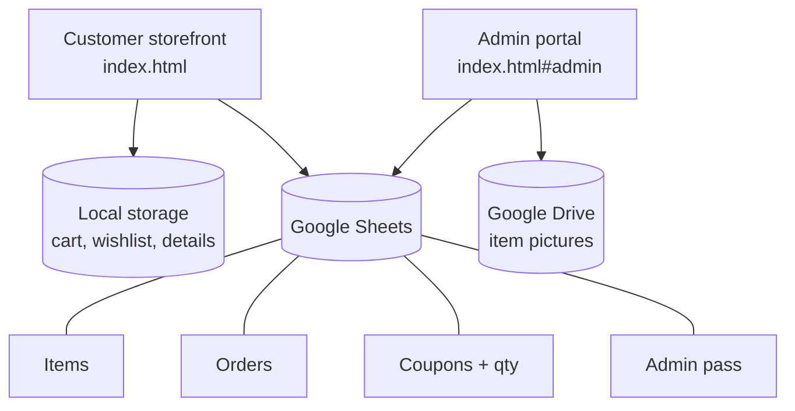
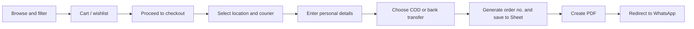
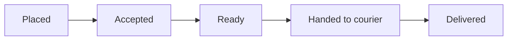

# Online Shop (Google Sheets Backend)

A lightweight online store with a customer storefront and an admin portal. Google Sheets is the database, Google Drive stores item pictures, and orders are confirmed to the shop through WhatsApp. No traditional server is needed.

> Replace `Online Shop` with your project name and fill in the `<placeholders>` below.

---

## Table of contents

- [Features](#features)
- [Architecture](#architecture)
- [Tech stack](#tech-stack)
- [Data model (Google Sheets)](#data-model-google-sheets)
- [Customer order flow](#customer-order-flow)
- [Order status lifecycle](#order-status-lifecycle)
- [Project structure](#project-structure)
- [Setup](#setup)
- [Admin portal](#admin-portal)
- [Security notes](#security-notes)
- [Roadmap](#roadmap)

---

## Features

### Customer storefront
- Browse items with pictures, price and sub-category
- Filters: **A to Z** and **price low to high**
- **Wishlist** and **cart**, saved in the browser (local storage)
- Checkout with location-based **courier company** selection and total calculation
- Payment options: **Cash on Delivery (COD)** or **bank transfer**
- Coupon codes
- Unique **order number** for every order
- **PDF** order summary
- Automatic redirect to **WhatsApp** to send the order to the shop
- **Order status** page: look up an order by its order number

### Admin portal
- Protected by an admin password
- **Item management**: add, edit and delete items (name, category, sub-category, price, cost, picture, quantity)
- **Order management**: accept orders, mark them ready, hand over to courier, mark delivered
- Add an **additional cost** to an order
- Delete orders
- Manage **coupons and stock quantity**

---

## Architecture



The customer site and the admin portal live in the same app. The admin portal is opened with the `#admin` route. Both read and write the same Google Sheet.

---

## Tech stack

| Layer | Technology |
|---|---|
| Frontend | HTML, CSS, JavaScript |
| Database | Google Sheets |
| File storage | Google Drive (item pictures) |
| Client-side state | Browser local storage |
| API bridge | `<Google Apps Script web app / Sheets API>` |
| Order confirmation | WhatsApp link redirect |
| Documents | PDF generation in the browser (`<library name>`) |

---

## Data model (Google Sheets)

| Sheet tab | Purpose | Main columns |
|---|---|---|
| **Items** | Product catalogue | Item ID, Name, Category, Sub-category, Price, Cost, Picture (Drive link) |
| **Orders** | Every placed order | Order No, Customer details, Items, Courier, Location, Total, Additional cost, Payment method, Status |
| **Coupons + qty** | Discounts and stock | Coupon code, Discount, Item ID, Quantity |
| **Admin pass** | Admin login password | Password |

> Adjust the column names to match your actual sheet.

### Browser local storage

| Key | Content |
|---|---|
| `wishlist` | Saved item IDs |
| `cart` | Items and quantities |
| `personalDetails` | Customer name, phone, address |
| `orderNo` | Last order number (used for status lookup) |

---

## Customer order flow



---

## Order status lifecycle



The admin updates the status in **Order management**. Customers see the current status on the **Order status** page using their order number.

---

## Project structure

> Update this tree to match your repository.

```
project-root/
├── index.html          # Storefront and admin portal (#admin route)
├── css/
│   └── style.css
├── js/
│   ├── app.js          # Routing, shared helpers
│   ├── shop.js         # Items, filters, wishlist, cart
│   ├── checkout.js     # Courier, details, payment, PDF, WhatsApp
│   ├── status.js       # Order status lookup
│   └── admin.js        # Item and order management
├── apps-script/
│   └── Code.gs         # Google Apps Script API for the Sheet
└── README.md
```

---

## Setup

### 1. Create the Google Sheet
1. Create a new Google Sheet.
2. Add the tabs: `Items`, `Orders`, `Coupons + qty`, `Admin pass`.
3. Add the column headers described in the [data model](#data-model-google-sheets).

### 2. Set up Google Drive
1. Create a folder for item pictures.
2. Share the folder so images can be displayed (view access).
3. Use each image's shareable link in the `Items` sheet.

### 3. Deploy the API
1. Open **Extensions → Apps Script** from the Sheet.
2. Paste the contents of `apps-script/Code.gs`.
3. Deploy as a **web app** and copy the URL.

### 4. Configure the frontend
Set these values in your config (for example at the top of `js/app.js`):

```js
const API_URL = "<your web app URL>";
const WHATSAPP_NUMBER = "<country code + number, no + sign>";
```

### 5. Run
Open `index.html` in a browser or host the folder on any static host (GitHub Pages, Netlify, and so on).

---

## Admin portal

Open `index.html#admin` and enter the admin password.

| Section | What you can do |
|---|---|
| **Item manage** | Add and edit items, set price, cost, sub-category and picture |
| **Order manage** | Accept, mark ready, hand over to courier, mark delivered, add extra cost, delete |

---

## Security notes

- Do **not** expose the password in the page source. Verify the admin password inside the Apps Script and return only success or failure to the browser.
- Restrict write actions (add item, change order status, delete) so they require a valid admin session.
- Keep customer personal details out of publicly readable sheets or links.
- Local storage is per browser. Customers clearing their browser data will lose cart, wishlist and saved details.

---

## Roadmap

- [ ] Automatic cost calculation for orders
- [ ] Email or WhatsApp notification on status change
- [ ] Sales and profit report from price and cost columns
- [ ] Multiple images per item

---

## License

`<Add your license, for example MIT>`
